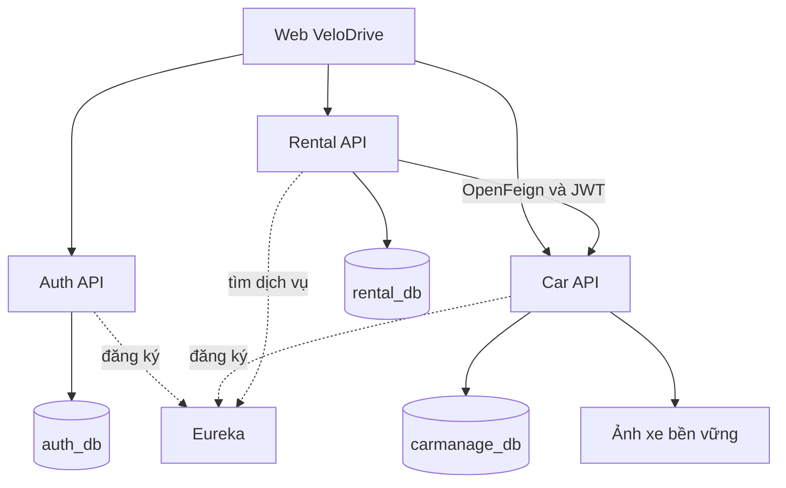
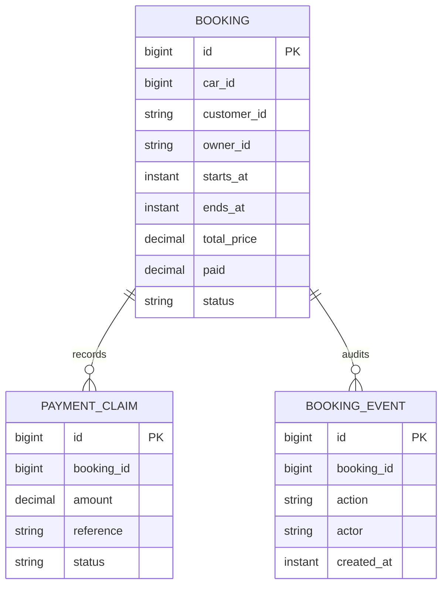
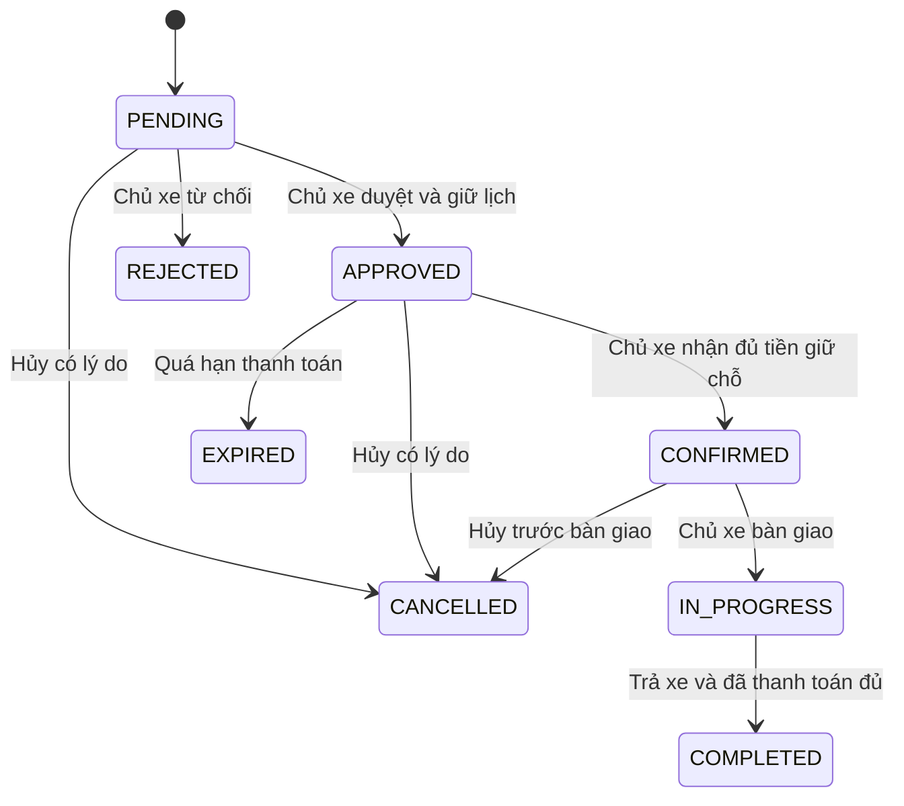

# Thiết kế SOA và hợp đồng nghiệp vụ

## Phân rã theo năng lực nghiệp vụ

Auth là nơi quản lý danh tính và cấp quyền; CarManage là nơi quản lý tài sản cho thuê;
Rental là nơi điều phối giao dịch thuê. Ba dịch vụ triển khai độc lập, giao tiếp REST/JSON,
JWT ký RSA và hợp đồng có kiểu dữ liệu. Eureka cung cấp registry, OpenFeign/LoadBalancer
phân giải `carmanage-service` thành địa chỉ instance. Không dùng IP/provider cố định trong mã gọi.

SOA thể hiện ở quyền sở hữu nghiệp vụ/dữ liệu và hợp đồng giữa dịch vụ, không chỉ ở số container.
Frontend phối hợp tìm xe/lịch; Rental chịu trách nhiệm kiểm tra lịch và giữ invariant khi duyệt.
Không có khóa ngoại hoặc JOIN xuyên DB. ID người dùng từ JWT và ID xe là tham chiếu logic;
đơn thuê lưu snapshot tên xe, ảnh, giá, chủ xe để lịch sử không thay đổi khi xe được chỉnh sửa.

## Sở hữu dữ liệu

| Dịch vụ | Thực thể | Ràng buộc chính |
|---|---|---|
| Auth | Account | Username duy nhất, BCrypt, role phía server, trạng thái enabled |
| Car | Car, CarPhoto, car_photo_links | Biển số duy nhất; ảnh thuộc người đăng; 0–6 ảnh tải lên; có ảnh dòng xe thì dùng được, ngoài danh mục cần ảnh tải lên |
| Rental | Booking, CalendarLock | UUID yêu cầu duy nhất theo khách; khóa theo car_id khi tạo/duyệt/thanh toán/chuyển trạng thái |
| Rental | PaymentClaim, BookingEvent | Mã tham chiếu duy nhất theo đơn; lịch sử append; paid chỉ tăng sau owner xác nhận |
| Rental | BillingSettings | Cấu hình nhận tiền theo owner_id; mask khi xem cài đặt |

## Chu trình trạng thái

Xe mới: POST hợp lệ → PUBLISHED; PUT hợp lệ vẫn PUBLISHED. Không có bước admin duyệt xe.
Lưu trữ thành ARCHIVED, không xóa các chuyến đã có. DRAFT/PENDING_REVIEW chỉ giữ để đọc dữ liệu cũ.
Bản cũ đã gửi chờ duyệt, đủ thông tin và ảnh hợp lệ được chuyển PUBLISHED lúc khởi động; chỉ cập nhật
listing_status/review_note có điều kiện, không ghi đè chủ sở hữu, giá hoặc địa chỉ. Migration chạy lại
không sinh xe mới. Bản nháp chưa gửi, dữ liệu mẫu, xe lưu trữ và bản thiếu thông tin giữ riêng.
Owner hoặc admin có thể bổ sung rồi lưu, hoặc gọi POST /api/cars/{id}/publish để đăng xe cũ đã đủ.
Dòng mẫu cũ giữ nguyên trong DB nhưng bị loại bởi cờ tương thích `demo_vehicle`; không có API nhập mẫu.

Không giữ lịch ở PENDING. APPROVED giữ đến paymentDeadline; CONFIRMED và IN_PROGRESS chặn lịch.
Hai khoảng trùng khi `start1 < end2 && end1 > start2`, nên trả và nhận đúng cùng mốc không trùng.
Xe đang IN_PROGRESS chặn cả lịch phía sau cho tới khi thực nhận lại xe, kể cả quá giờ trả dự kiến.
Dùng bảng booking_calendars với INSERT ON CONFLICT + SELECT FOR UPDATE trong transaction
PostgreSQL để tuần tự hóa mọi thao tác trên cùng xe. Kiểm tra lại trạng thái/giá/lịch ở backend,
không tin kết quả lọc hoặc tổng tiền do trình duyệt gửi.

Idempotency-Key 16–80 ký tự cho POST /api/bookings; cùng khách và cùng khóa với nội dung khác trả409.
Mã giao dịch lặp lại không cộng tiền hai lần. Khi hủy/hết hạn, refundDue bằng số đã thực nhận;
việc hoàn trả cần ghi nhận riêng sau khi chuyển/hoàn tiền thực tế. Giao dịch PENDING không tăng paid.
Không mô phỏng kết nối ngân hàng hoặc giả mạo biên nhận tự động.

## Tích hợp và lỗi

Rental là consumer, Car là provider cho GET /api/cars/{id}. Rental chuyển tiếp JWT khách/chủ xe,
Car tự kiểm tra issuer, audience, expiry và quyền. Quote yêu cầu xe PUBLISHED/AVAILABLE,
kiểm tra kiểu/giá/owner từ phản hồi. Timeout kết nối2s, đọc4s; 404 khi thiếu xe, 409 khi trùng lịch
hoặc trạng thái không phù hợp, 502 khi provider trả lỗi/dữ liệu sai, 503 khi không có provider,
504 khi chờ quá thời gian. Không trả giá/báo giá dự phòng hư cấu khi provider lỗi.

Hệ thống dùng REST đồng bộ và transaction cục bộ. Không ghi đồng thời nhiều DB; Rental có thể
lưu snapshot hợp lệ rồi quản lý vòng đời độc lập. Những thay đổi xe sau khi gửi yêu cầu được
kiểm tra lại lúc duyệt; giá của đơn đã gửi được giữ theo snapshot, chủ xe chọn duyệt hoặc từ chối.

## Bảo mật và dữ liệu nhạy cảm

Authentication xác định tài khoản qua BCrypt/JWT; Authorization kiểm tra thao tác; Role nhóm
trách nhiệm; Permission là quyền API, ví dụ car:read hoặc car:write:own. Owner chỉ sửa ảnh/xe
của mình và xử lý đơn của xe mình; customer chỉ xử lý đơn của mình; admin quản lý xe và tài khoản.
Đăng ký không chấp nhận ADMIN, client không gán owner_id, endpoint hồ sơ lấy subject từ JWT.

Thông tin hồ sơ trả DTO được che; số điện thoại chỉ còn ba số cuối. Ảnh loại EXIF/GPS trước lưu.
Không log JWT, password, profile hay tài khoản ngân hàng. Ảnh đã tải là tài nguyên công khai
bằng ID ngẫu nhiên; hướng dẫn người dùng không đưa giấy tờ vào ảnh. Bank instructions chỉ trả
cho các bên có quyền sau khi đơn được duyệt. JWT phía dịch vụ xác minh offline, có thời hạn15 phút;
thu hồi tức thời sau khóa tài khoản/đổi mật khẩu chưa triển khai cho token đã cấp.

Giao tiếp hiện tại là HTTP trong network Docker riêng và cổng localhost. Triển khai thực tế cần
TLS/mTLS hoặc gateway phù hợp, bí mật từ secret manager và CORS theo domain của đơn vị vận hành.
Không nhận dữ liệu y tế; dữ liệu thuê xe vẫn có PII và giao dịch tài chính nên áp dụng tối thiểu hóa,
phân quyền theo chủ tài nguyên và lưu dấu thao tác. Chưa tích hợp định danh/eKYC, bảo hiểm, chữ ký
hợp đồng, email/SMS hay ngân hàng; không có badge xác thực giả trên giao diện.

## Tham khảo luồng người dùng

Mioto hướng dẫn chọn xe/thời gian, gửi yêu cầu, chủ xe đồng ý rồi mới thanh toán giữ chỗ,
nhận và trả xe. Nguồn công khai: https://www.mioto.vn/howitwork , https://www.mioto.vn/bookinghowto ,
https://www.mioto.vn/paymenthowto . Chỉ tham khảo quy trình sử dụng; không suy đoán kiến trúc nội bộ.

## Danh mục và địa điểm trên storefront

CarManage cung cấp hai hợp đồng đọc công khai: `GET /api/car-catalog` và
`GET /api/locations/provinces`. Catalog có 21 dòng xe, ảnh và thông số cơ bản;
ProvinceDirectory có 34 tỉnh/thành và alias tên cũ. Chúng là metadata của dịch vụ,
không phải bản ghi Car có owner/biển số/lịch thuê. Hai trường displayPricePerDay và displayCity là cấu hình hiển thị độc lập với dữ liệu xe đã đăng. Không có bộ ghi xe vào DB khi đọc catalog.

Customer phối hợp catalog, `GET /api/cars?city=...&model=...` và availability của Rental.
Chỉ xe đã công bố và còn lịch trống mới có thể đi tiếp đến báo giá/đặt thuê. Nếu Rental
lỗi, danh mục vẫn hiển thị và lịch được ghi là chưa kiểm tra, không suy ra xe đang sẵn sàng.
Ảnh đúng dòng xe được dùng khi thiếu ảnh hiển thị; ảnh upload được ưu tiên. Kiểm tra quyền
ảnh vẫn kiểm tra chủ sở hữu; ảnh dòng xe không tạo bản ghi ảnh tải lên. Không thêm bảng, không seed Car.
PublicationRules kiểm tra độ đầy đủ trước create/update/publish và khi chuyển trạng thái xe chờ duyệt cũ.

Giá/địa điểm danh mục được cấu hình trong tài nguyên của CarManage, trả qua API
catalog công khai và không thực hiện ghi DB. Client ưu tiên chiếc xe phù hợp có
lịch trống trước khi dùng giá/địa điểm cấu hình; mỗi cặp giá/địa điểm trên thẻ lấy
cùng một nguồn. API báo giá Rental tiếp tục đọc giá của Car qua hợp đồng HTTP và
kiểm tra lịch/giá ở server. Không dùng giá của danh mục để tạo invoice hoặc đơn thuê.

## Hợp đồng đăng xe

`POST /api/cars` trả 201, `PUT /api/cars/{id}` trả 200 với PUBLISHED khi đủ dữ liệu. Thiếu thông tin trả 400 và không lưu một phần. `POST /api/cars/{id}/publish` dùng cho xe cũ; URL `/submit` là alias tương thích, đăng ngay và không vào hàng chờ. URL `/review` đã ngừng sử dụng, ADMIN gọi trả 410. Customer không được ghi xe; owner chỉ ghi xe của mình. Ranh giới Auth/Car/Rental, xác nhận yêu cầu thuê và snapshot đơn thuê không thay đổi.
